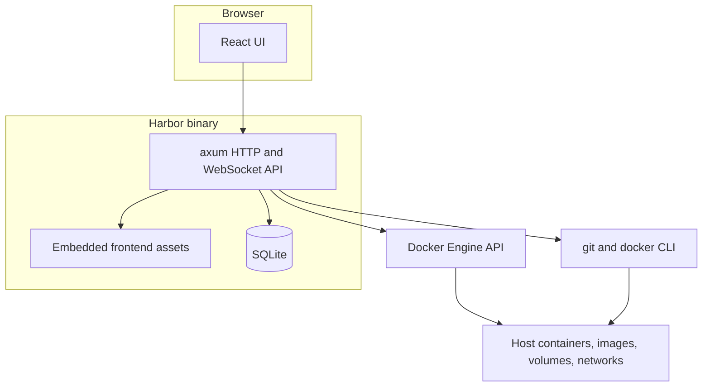

# Harbor

A self-hosted dashboard for deploying and managing Docker workloads on a single server. The Rust (axum) backend stores state in SQLite, talks to the Docker Engine API, and serves an embedded React frontend from the same binary.

[](https://github.com/adeyahya/harbor/actions/workflows/ci.yml)

Inspired by [Komodo](https://komo.do), with a Railway-like canvas for stacks, git-built containers, rollbacks, promotion between environments, and scheduled volume backups.

## Screenshots

Add captures of the canvas, a deployment panel, and the container terminal under [`docs/screenshots/`](docs/screenshots/) and uncomment the lines below. Keep hostnames, account names, and anything from a real server out of the images.

<!--


-->

_Screenshots are not in the repository yet._

## Quick start

Docker is the only requirement. The Compose file builds the image, mounts the engine socket, and stores Harbor's database under `/var/lib/harbor`.

```bash
git clone https://github.com/adeyahya/harbor.git
cd harbor
sudo mkdir -p /var/lib/harbor
docker compose up -d --build
```

Open http://127.0.0.1:9120 and create the admin account. Change `hostname:` in [`compose.yaml`](compose.yaml) if you want the canvas to show the server's name instead of `my-server`.

Tagged releases are published to `ghcr.io/adeyahya/harbor` (the tag, and `latest`). Pull requests and `main` only build the image; they do not push it. See [Running Harbor in Docker](#running-harbor-in-docker) for the socket mount, the data directory, and host networking.

## Features

- **Canvas**: every stack and deployment as a card with live status, services
  and published ports, plus host CPU/memory/disk. Clicking a card opens its
  panel with Deployments, Logs, Variables and Settings tabs. Press ⌘K to search.
  Pin important services to the top and put the rest in named, collapsible
  groups (⋯ on a card); the layout is stored on the server.
- **Stacks**: Docker Compose projects. The compose file is either edited in the
  UI or comes from a **git repository** (with auto-deploy on push, like
  deployments). Variables are written to a `.env` file; deploy, pull, restart,
  stop or take them down. Stacks can run from a chosen project directory so
  relative paths in the compose file keep working.
- **Deployments**: single containers with ports, volumes, environment,
  network, restart policy and command. The image comes from either:
  - a **registry image**, pulled on each deploy, or
  - a **git repository** (GitHub `owner/repo` or any git URL): Harbor
    shallow-clones the branch, builds its Dockerfile into
    `harbor/<name>:<commit>`, and recreates the container. Optional root
    directory, Dockerfile path, build args, and an access token for private
    repos. With **auto-deploy** on, new commits are deployed automatically.

  The port editor flags host ports already taken (by a container, Harbor, or
  another process), suggests free ones, and offers the ports the image
  `EXPOSE`s.
- **Rollback**: every successful deploy records the exact image it ran (the
  built `harbor/<name>:<commit>` tag, or the pulled image's ID) and the
  settings it ran with. Rolling back reruns that image with those settings, with
  no rebuild or pull. Stacks roll back their compose file and variables.
- **Environments** (staging → production): a deployment can take its image
  from another deployment instead of a registry or repository. **Promote**
  runs the exact image one of the upstream's deploys ran, with the
  deployment's own ports, variables and volumes, so production gets what staging
  tested. See [Staging and production](#staging-and-production).
- **Containers**: list, start/stop/restart/remove, live log streaming, inspect.
- **Terminal**: open a shell in any running container (Containers, or the
  Terminal tab of a deployment or stack), with bash or sh picked automatically
  and an optional user to run as. Each session is recorded in Activity (who,
  which shell, how long, never what was typed) and can be ended from there.
- **Images, volumes, networks**: list, remove, prune. Click a volume to browse its
  files read-only: folders, text previews, image previews and downloads. Harbor
  reads volumes through a small `alpine` helper container (pulled on first use,
  removed after 10 minutes idle, hidden from Harbor's lists), so it works
  even when volume data lives in a VM, as with Docker Desktop.
- **Volume backups**: schedule backups of a volume to **Google Drive**, a
  **local folder**, or any **rclone** remote (S3, Backblaze B2, Dropbox,
  OneDrive, SFTP, …). Keeps the last N, can stop the containers using the
  volume while archiving, and restores into the same or a new volume. See
  [Volume backups](#volume-backups).
- **Git accounts** (Settings): credentials stored once and used by every
  git-backed service. Services use the account for their repository's host
  automatically, or a specific one, or none.
- **Import existing containers** (e.g. from Komodo): compose projects become
  stacks and standalone containers become deployments, without restarting
  anything. See [Moving from Komodo](#moving-from-komodo).
- **Activity**: every action is recorded with its status and full output, and
  streamed live while it runs.
- **Auth**: the first visit creates an admin account. Sessions use an httpOnly cookie.

## Architecture

The browser talks only to Harbor. The React app is built with Vite and embedded in the binary at compile time (`rust-embed`), so there is no separate frontend process in production. axum serves that UI, the JSON API, server-sent log streams, and the terminal WebSocket. SQLite holds users, sessions, deployments, stacks, activity, and backup settings. Deployments and stacks are applied by calling the Docker Engine API (bollard) and, for Compose and image builds, the `docker` and `git` binaries.



| Piece | Where |
| --- | --- |
| HTTP API, sessions, background deploys | `backend/src` (axum, tokio) |
| Schema | `backend/migrations` (applied on startup) |
| UI | `frontend/src` (React, Vite, shadcn/ui) |
| Image | [`Dockerfile`](Dockerfile) multi-stage build, [`compose.yaml`](compose.yaml) |
| CI | [`.github/workflows/ci.yml`](.github/workflows/ci.yml) (Rust and frontend), [`.github/workflows/docker.yml`](.github/workflows/docker.yml) (image, push to GHCR on tags) |

## Configuration

| Variable          | Default          | Description                                  |
| ----------------- | ---------------- | -------------------------------------------- |
| `HARBOR_ADDR`     | `127.0.0.1:9120` | Listen address. Use `0.0.0.0:9120` to expose (the Docker image does). |
| `HARBOR_DATA_DIR` | `./data`         | SQLite database and stack files (`/var/lib/harbor` in the Docker image). |
| `DOCKER_HOST`     | active context   | Docker engine to manage (`unix:///var/run/docker.sock` in the Docker image). |
| `HARBOR_GIT_POLL_SECS` | `60`        | How often auto-deploy checks branches for new commits. `0` disables polling. |
| `HARBOR_HELPER_IDLE_SECS` | `600`    | How long an idle volume-browser helper container is kept. |
| `RUST_LOG`        | `harbor=info`    | Log filter.                                  |

Harbor connects to the same engine as your `docker` CLI: `DOCKER_HOST` if set, otherwise the active `docker context` (for example Docker Desktop on macOS).

Git tokens, webhook secrets, and backup credentials are not environment variables. They are written to the SQLite database through the UI and are not returned to the browser.

## Security

Harbor controls the Docker engine, which is root-equivalent on the host. An admin session is comparable to SSH on that machine.

- Do not publish port 9120 on the public internet without a TLS reverse proxy. Prefer a private network or VPN. Details are in [Running Harbor in Docker](#running-harbor-in-docker) and [Reverse proxy and webhooks](#reverse-proxy-and-webhooks).
- The first visitor creates the only admin account. The session cookie is httpOnly. There are no extra roles.
- The database under `HARBOR_DATA_DIR` holds password hashes and third-party secrets (git tokens, Google OAuth client secrets and refresh tokens, rclone configs). Back it up like a password store, and do not commit it. `.gitignore` ignores `data/`, `*.db`, `*.sqlite`, and `.env` files.
- GitHub push webhooks are verified with HMAC-SHA256 (`X-Hub-Signature-256`). Container terminals require the WebSocket `Origin` to match Harbor's host.
- Report vulnerabilities privately. See [SECURITY.md](SECURITY.md).

## Development

Rust 1.98 (see [`rust-toolchain.toml`](rust-toolchain.toml)), Node.js 22, and pnpm 11. Docker with the Compose plugin and `git` are needed to actually deploy.

Run the backend and the Vite dev server in two terminals. Vite proxies `/api` to the backend and hot-reloads the UI:

```bash
cd backend && cargo run
```

```bash
cd frontend && pnpm install && pnpm dev
```

Then open http://localhost:5173.

To build the UI into the binary and run a release build on the host:

```bash
cd frontend && pnpm install && pnpm build
cd ../backend && cargo run --release
```

Open http://127.0.0.1:9120 and create your admin account.

The checks CI runs are listed in [CONTRIBUTING.md](CONTRIBUTING.md).

## Running Harbor in Docker

The repository ships a multi-stage `Dockerfile` (it builds the UI and the Rust
binary, then copies them into a slim Debian image with `git` and the Docker CLI,
Compose and Buildx) and a `compose.yaml` that runs it.

```bash
git clone https://github.com/adeyahya/harbor.git
cd harbor
sudo mkdir -p /var/lib/harbor
docker compose up -d --build
```

Then open `http://<server>:9120` and create the admin account. Edit `hostname:`
in `compose.yaml` first if you want the dashboard to show your server's name.

### How it works and what it needs

- **The Docker socket.** Harbor drives the *host's* Docker engine through
  `/var/run/docker.sock`. Without that mount Harbor exits at startup with
  `Socket not found: /var/run/docker.sock`. If your socket lives elsewhere
  (rootless Docker, Podman), mount it and set `DOCKER_HOST=unix:///path/to/socket`.
- **The data directory at the same path on both sides.** Stacks run with
  `docker compose` inside Harbor's container, but the host's Docker resolves
  bind-mount paths, and it resolves them **on the host**. A stack's
  `./config:/config` becomes `<data dir>/stacks/<name>/config`, so that path has
  to mean the same thing on the host and in the container:

  ```yaml
  volumes:
    - /var/lib/harbor:/var/lib/harbor   # same path both sides
  environment:
    HARBOR_DATA_DIR: /var/lib/harbor
  ```

  To use another location, change all three to the same path. Don't use a named
  volume here: Harbor would start, but relative bind mounts in stacks would
  point at empty directories on the host.
- **Runs as root.** Access to the Docker socket is root-equivalent on the host
  anyway, so there's no meaningful privilege drop to make. Treat Harbor like
  SSH access to the server: put it behind a reverse proxy with TLS, or keep it
  on a private network or VPN.
- **Harbor sees itself.** Its own container appears in the Containers list.
  Stopping or removing it from the UI stops Harbor (`unless-stopped` won't bring
  it back after a manual stop); start it again with `docker compose up -d`.

### Host networking (Linux)

With the default port mapping Harbor can only check Docker-published ports when
it suggests free host ports; other processes on the host are invisible from the
container's network. The host stats on the canvas are also the container's view
(e.g. disk usage of the filesystem it sees). On a Linux server you can run with
host networking for accurate port checks, and to bind to localhost behind a
reverse proxy:

```yaml
services:
  harbor:
    network_mode: host        # replaces "ports:"
    environment:
      HARBOR_ADDR: 127.0.0.1:9120   # or 0.0.0.0:9120 to expose directly
```

Docker Desktop (macOS/Windows) handles host networking differently; keep the
port mapping there.

### Reverse proxy and webhooks

Any reverse proxy works. Live logs stream over server-sent events, so turn off
response buffering for Harbor, and container terminals use WebSockets, so the
proxy must pass `Upgrade` requests through (Caddy does by default; nginx needs
`proxy_set_header Upgrade $http_upgrade; proxy_set_header Connection "upgrade";`).
Terminals check the browser's `Origin` against the `Host` (or
`X-Forwarded-Host`) header, so keep the original host when proxying. For example, with Caddy:

```
harbor.example.com {
    reverse_proxy 127.0.0.1:9120 {
        flush_interval -1
    }
}
```

GitHub webhooks then use `https://harbor.example.com/api/webhooks/github/<service>`.

### Upgrading and backups

```bash
git pull && docker compose up -d --build
```

Database migrations run automatically at startup. Everything Harbor stores is
in the data directory: back up `harbor.db` (stop Harbor first, or use
`sqlite3 harbor.db ".backup backup.db"`) and the `stacks/` folder. Volumes and
images used by your services live in Docker as usual; back up volumes with
[Volume backups](#volume-backups).

On a tag, GitHub Actions pushes `ghcr.io/adeyahya/harbor:<tag>` and `:latest`. To run a published image instead of building locally, set `image:` in `compose.yaml` and drop the `build:` key.

## Moving from Komodo

Harbor can take over containers that Komodo (or anything else) started on the
same Docker engine. Open **Import** (the banner on the canvas, *Create → Import
existing containers*, or ⌘K):

- **Komodo stacks** (compose projects) import as stacks. Harbor reads the
  compose file and `.env` from the project's directory and keeps running the
  stack from that directory, so relative paths behave as before. If the
  directory is a git checkout (Komodo's git-backed stacks), Harbor offers to use
  the repository: deploys then fetch the branch into that checkout and reset to
  it. Local edits to tracked files are discarded; untracked files such as data
  folders are kept.
- **Komodo deployments** (single containers) import as deployments. Harbor
  derives image, ports, volumes, variables (without the image's defaults),
  labels, network and restart policy from the running container, and lists
  anything it can't carry over yet (capabilities, devices, resource limits,
  custom entrypoint, …) before you confirm. Afterwards you can switch the
  source to a GitHub repository in Settings.

Importing never restarts anything. The containers keep running until you
deploy from Harbor, which recreates them with Harbor's settings (an imported
deployment is renamed to its Harbor name at that point). Komodo's own
containers are flagged and not counted.

Before importing, **stop Komodo from managing those services** (remove them from
Komodo, or stop Komodo's Periphery agent), otherwise both tools will redeploy
them. Your data in named volumes is untouched by either.

If Harbor runs in Docker, mount Komodo's directory at the same path so Harbor
can read the compose files and run the stacks from there:

```yaml
volumes:
  - /etc/komodo:/etc/komodo
```

## Volume backups

1. **Settings → Backup destinations → Add destination**:
   - **Google Drive**: see [below](#google-drive) for the one-time client
     setup, then click **Connect** and sign in.
   - **Local folder**: an absolute path as Harbor sees it. In Docker, use a
     folder under the data directory (e.g. `/var/lib/harbor/backups`) or mount
     another disk into Harbor's container.
   - **rclone remote**: paste remotes in `rclone.conf` format (e.g. from
     `rclone config show myremote`) and a path like `myremote:bucket/harbor`.
     Harbor runs `rclone/rclone` in a helper container, so nothing needs to be
     installed. The config is stored in Harbor's database.
   **Test** checks that the destination is reachable and writable.
2. Open a volume (**Volumes → *name* → Backups**) and **Add schedule**: pick
   the destination, when to run (presets or any cron expression, in the
   server's time zone; set `TZ` and mount `/etc/localtime` to change it), how
   many backups to keep, and whether to stop the containers using the volume
   while it's archived. Stopping them is recommended for databases, which can
   otherwise be copied mid-write. **Back up now** makes a one-off backup.
3. **Restore** downloads a backup and replaces the volume's contents with it,
   optionally stopping its containers meanwhile. The archive is extracted to a
   staging folder first, so a damaged backup leaves the volume untouched. Pick
   another volume name to restore into a new volume instead.

Backups are `<volume>-<UTC timestamp>.tar.gz` archives of the volume's
contents, made by a short-lived `alpine` helper container (so this works when
volume data lives in a VM). Each archive is staged in `<data dir>/backups/tmp`
before upload, so that disk needs room for the largest one. Every run is an
update in Activity with its full log. A run missed while Harbor was down
happens once when it starts again.

### Google Drive

Google requires each self-hosted app to use its own OAuth client. Once:

1. In the [Google Cloud console](https://console.cloud.google.com/projectcreate),
   create a project and enable the
   [Google Drive API](https://console.cloud.google.com/apis/library/drive.googleapis.com).
2. Configure the [OAuth consent screen](https://console.cloud.google.com/auth/branding)
   (External) and **publish** the app under *Audience*. Apps left in testing
   lose access after 7 days. Harbor only asks for the `drive.file` scope
   (files it created itself), so publishing needs no verification.
3. Under [Clients](https://console.cloud.google.com/auth/clients), create a
   client:
   - **Web application**, if you open Harbor over https (or on localhost), with
     the authorized redirect URI
     `https://<harbor-host>/api/backups/destinations/google/callback`. Google
     sends you back to Harbor after you sign in.
   - **Desktop app** otherwise. After you sign in Google opens
     `http://localhost/?…&code=…`, which won't load; paste that address into
     Harbor.
4. Add the destination in Harbor with the client ID and secret, then
   **Connect**.

Backups go in a Drive folder (default *Harbor backups*), uploaded with resumable
uploads that survive dropped connections. The refresh token and client secret
are stored in Harbor's database and never sent to the browser. Do not put the
client secret in this repository or in a committed `.env` file.

## Deploying from GitHub

1. **Create → GitHub repo**, enter `owner/repo` (leave the branch empty to use
   the default branch), then set ports and variables in the service's Settings.
2. **Private repos:** add a GitHub account under **Settings → Git accounts**
   with a [fine-grained token](https://github.com/settings/personal-access-tokens)
   that has read-only *Contents* access. Every service whose repository is on
   that host uses it automatically; pick a different account (or none) in a
   service's Settings. Tokens are stored in Harbor's database and never sent
   back to the browser.
3. **Deploy on push:** turn on *Auto-deploy*. Harbor polls the branch (see
   `HARBOR_GIT_POLL_SECS`), which works even when GitHub can't reach your server.
   For instant deploys, add a GitHub webhook pointing at
   `https://<harbor-host>/api/webhooks/github/<service-name>`, with content type
   `application/json`, the secret shown in Settings, and just the push event.
   Requests are verified with the `X-Hub-Signature-256` HMAC.

**Redeploying** a commit that was already built reuses its image: Harbor
checks the branch head with `git ls-remote`, and if `harbor/<name>:<commit>`
exists it just recreates the container, so changing variables or ports and
redeploying takes seconds. **⋯ → Rebuild** builds the commit again anyway,
pulling newer base images. When a build is needed, Harbor fetches into the
checkout it keeps under its data folder instead of cloning again.

Each build is kept as `harbor/<name>:<commit>` so it can be rolled back to.
Builds are labelled `harbor.deployment` and **"Prune unused" on the Images page
skips them**; remove old builds individually there when you need the space.
Rolling back after the target image has been removed fails with a clear error
and leaves the running container alone. A rollback doesn't change what
auto-deploy considers "seen", so it won't immediately redeploy the newer
commit, but the next push deploys as usual.

## Staging and production

Build or pull once, then promote the same image:

1. Set up staging as usual, e.g. a GitHub deployment `api-staging` with
   auto-deploy on.
2. On its panel, **⋯ → New environment…** creates `api-production`, whose
   source is *Another deployment* (`api-staging`). Variables, network, restart
   policy and command are copied. Ports, volumes and labels aren't, so give
   production its own.
3. **Promote** on production runs whatever staging runs now. The Deployments tab
   compares the two and lists staging's earlier deploys, so you can promote any of
   them. Nothing is rebuilt or pulled. Registry images are promoted by image ID,
   so a moving tag like `:latest` can't change what production gets.
4. Optionally turn on **Auto-promote** to promote every successful staging
   deploy as soon as it finishes. Chains such as dev → staging → production
   work the same way.

Production keeps its own history and rolls back like any other deployment. A
deployment that others promote from can't be deleted until their source is
changed. Promotion only carries the image, so configuration baked in at build
time (build arguments, variables compiled into a frontend bundle) is the same in
every environment. Pass environment-specific values as variables instead.

## Layout

```
Dockerfile         multi-stage image build (UI + binary + docker CLI and git)
compose.yaml       runs Harbor itself in Docker
backend/
  migrations/      SQLite schema (applied on startup)
  src/
    main.rs        startup, routing, Docker connection
    auth.rs        setup/login/logout, session middleware
    updates.rs     action records + background task runner
    stacks.rs      compose stacks
    deployments.rs single-container deployments, GitHub webhook, auto-deploy poller
    git.rs         clone, docker build, remote head lookup, webhook signatures
    process.rs     runs git/docker commands with output streamed to updates
    ports.rs       host port availability and suggestions
    import.rs      discovering and importing containers Harbor didn't create
    canvas.rs      canvas groups and pinning
    accounts.rs    git accounts and token resolution
    volume_browser.rs  read-only volume file browser (helper container)
    terminal.rs    container shells over WebSocket
    backups.rs     volume backup schedules, archiving and restoring
    backup_destinations.rs  Google Drive, local folder and rclone targets
    docker.rs      containers, logs (SSE), images, volumes, networks
    system.rs      host stats collector
    assets.rs      embedded frontend
frontend/
  src/
    api.ts         API client and types
    components/ui/ shadcn/ui primitives (generated; edit sparingly)
    components/app/ app components: layout, service panel, log viewer,
                   variables editor, command menu, action tray
    pages/         canvas, service panels, Docker resource pages
```

## Roadmap

Not built yet, and present in Komodo:

- Multiple servers, instead of the one engine Harbor is attached to
- Procedures and one-off actions
- GitOps sync of resources from a repository
- Alerting

Git-backed stacks, promotion between environments, container terminals, and scheduled volume backups are already in.

## Contributing

See [CONTRIBUTING.md](CONTRIBUTING.md). The project is licensed under the [MIT License](LICENSE). Copyright Ade Yahya.
